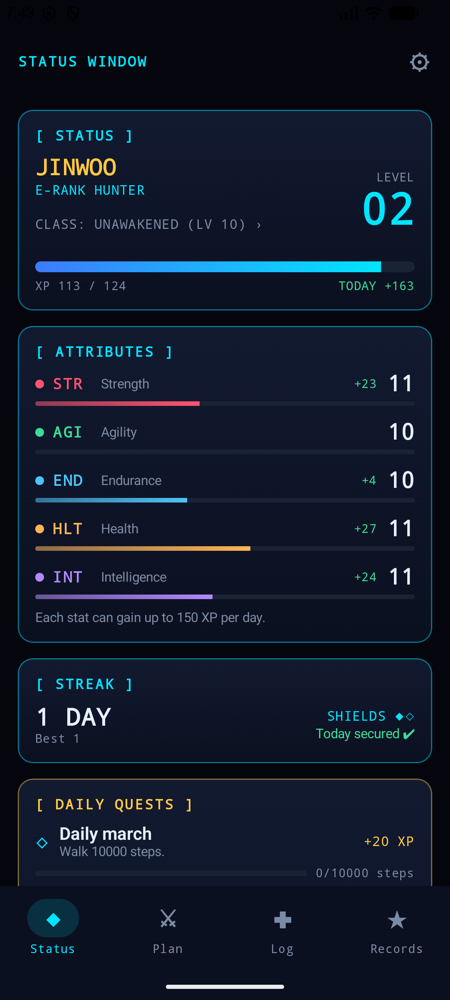
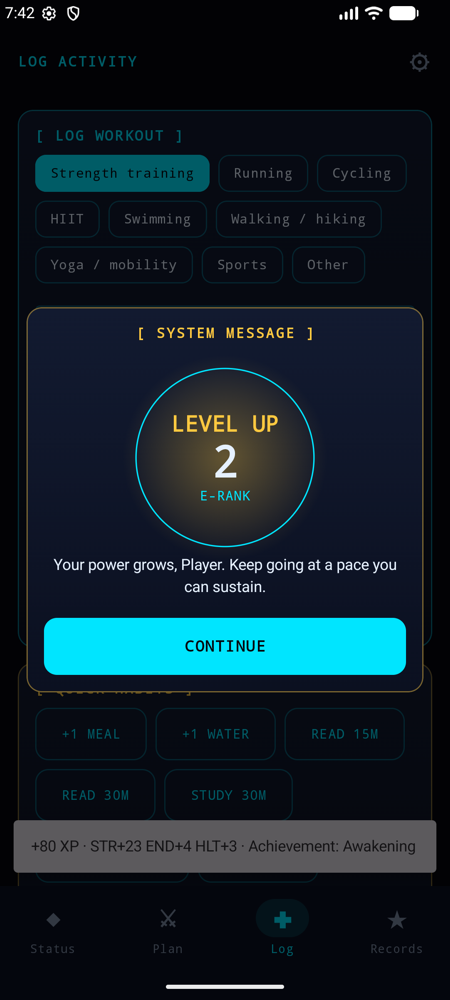
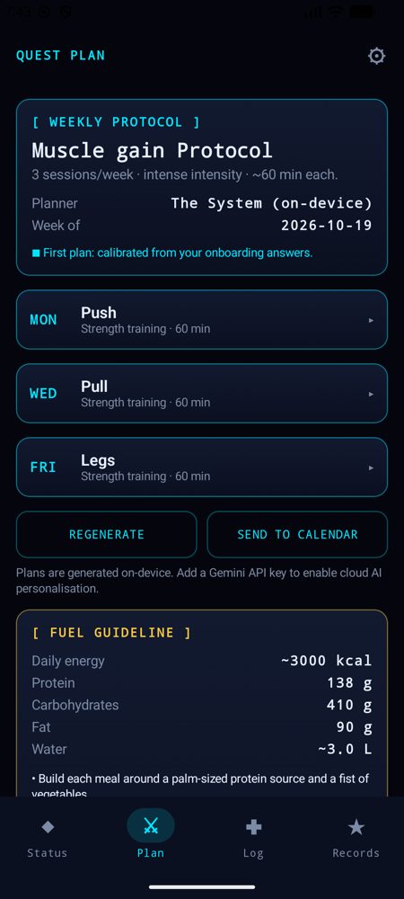
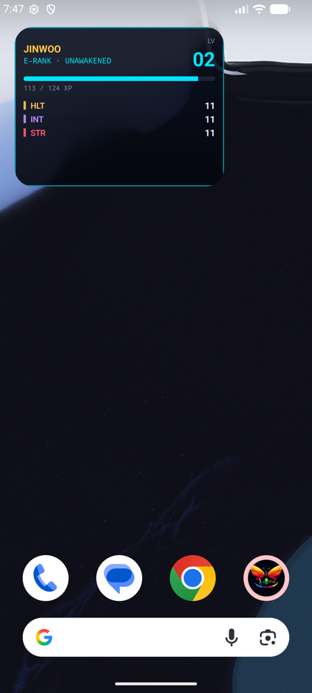

<p align="center">
  
</p>

<h1 align="center">Monarch</h1>

<p align="center">
  <b>Your real-life workouts, as an RPG.</b><br/>
  Steps, training, sleep, meals and study become XP, five stats and levels 1–100.<br/>
  Android · Kotlin · Jetpack Compose · offline-first
</p>

<p align="center">
  <a href="https://github.com/pronzzz/monarch/releases/latest">Download the latest APK</a> ·
  <a href="CHANGELOG.md">Changelog</a> ·
  <a href="LICENSE">MIT License</a>
</p>

<p align="center">
  
  
  
  
</p>

## What it does

- **Stat window.** Level, rank (E→S), class, XP bar and five stats: Strength, Agility, Endurance, Health and Intelligence.
- **Automatic sync.** Reads steps, workouts, sleep and active calories from **Health Connect**, which carries data from Samsung Health, Zepp/Amazfit, Google Fit, Fitbit and others. Can also connect **Strava** directly. The same workout seen by two sources only counts once.
- **Manual logging.** For workouts plus quick habits (meals, water, reading, study, meditation, sleep), with undo.
- **Personal weekly plan.** Generated on-device in seconds, or by Gemini when a key is configured. It adapts every week to how many sessions you actually completed. Basic nutrition targets come from standard formulas. All of this is clearly marked as not medical advice.
- **Calendar sync.** Sends sessions to your phone's calendar, so they reach Google Calendar if a Google account is on the device.
- **Progression.** Daily quests, 18 achievements, classes that unlock at levels 10 and 20, and a level-up animation.
- **Kind by design.** Rest days never break a streak, streak shields cover missed days, and XP is never taken away.
- **Home-screen widget.** A live status HUD in minimal or detailed mode that updates the moment you log something.

## Install

Grab `monarch-<version>.apk` from [Releases](https://github.com/pronzzz/monarch/releases) and open it on an Android 8.0+ phone. You'll need to allow installs from your browser or file manager.

Health Connect is built into Android 14+. On older versions, install it from the Play Store when the app asks.

## Connecting your data sources

| Source | How it reaches Monarch | Setup |
|---|---|---|
| Samsung Health | Health Connect | In Samsung Health, open Settings › Health Connect and allow steps, exercise and sleep |
| Zepp / Amazfit | Health Connect | In Zepp, find Health Connect under your profile's connected apps. Some older watches aren't supported |
| Zepp Life (Mi Band) | Health Connect | In Zepp Life, open Profile › connected accounts › Health Connect |
| Google Fit, Fitbit | Health Connect | Turn on Health Connect sharing in the app |
| Strava | Direct API **or** Health Connect | In Monarch, open Settings › Sync sources › Connect Strava (needs API keys in the build, see below) |

Samsung Health and Zepp don't offer open APIs to third-party apps, so Health Connect is how their data reaches Monarch. Monarch's **Settings › Sync sources** shows each app as *Not installed*, *Turn on sharing* or *Sending data*, with a shortcut to open it.

## Build from source

Requirements: JDK 17+ and the Android SDK with platform 37.

```bash
./gradlew :app:installDebug
```

Optional keys go in `local.properties`, which is git-ignored. Anything missing just switches that feature off.

```properties
# Cloud AI planner. Without it, the on-device planner is used.
GEMINI_API_KEY=...
GEMINI_MODEL=gemini-2.5-flash

# Google Sign-In: an OAuth "Web application" client ID, with the app's SHA-1 registered on an Android client.
GOOGLE_WEB_CLIENT_ID=...

# Strava direct sync. Create an app at strava.com/settings/api and set its callback domain to "localhost".
STRAVA_CLIENT_ID=...
STRAVA_CLIENT_SECRET=...

# Release signing. Without it, release APKs are unsigned.
MONARCH_KEYSTORE=/path/to/monarch-release.jks
MONARCH_KEYSTORE_PASSWORD=...
MONARCH_KEY_ALIAS=monarch
MONARCH_KEY_PASSWORD=...
```

```bash
./gradlew :app:assembleRelease   # R8-minified, signed if the keystore is configured
```

## Tests

```bash
./gradlew :app:testDebugUnitTest           # 104 JVM tests
./gradlew :app:connectedDebugAndroidTest   # 10 device tests (wipes app data on that device)
```

- **Unit tests** cover the game math, progression service, multi-source sync and de-duplication, the Strava OAuth/refresh/paging client, and LLM output sanitising.
- **Device tests** cover the Room repositories, concurrent daily-cap enforcement, the v1→v2 schema migration, Keystore token encryption, real calendar writes, DataStore, and a full UI journey from onboarding through logging, level-up, achievements, class lock and reset.

## Architecture

```
domain/        Pure Kotlin. Models, game engines (level curve, stat scaling, XP rules and caps,
               streaks, quests, achievements, diet, planner, adaptation, de-duplication) and services.
data/          Room, DataStore, Health Connect, Strava (OAuth + API), Gemini client, CalendarContract,
               Credential Manager, Keystore-encrypted secrets.
ui/            Compose screens + ViewModels (MVVM), theme, navigation.
widget/        Glance home-screen widget (observes live status).
work/          Hourly sync worker and an optional once-a-day quest notice.
tools/         generate_icon.py: regenerates the launcher icon and store art from one geometry source.
```

The **XP ledger is the single source of truth.** Every award is a row with an idempotency key, such as `workout:42`, `steps:2026-10-20` or `quest:2026-10-20:move`. Level, stats and streak are always derived from the ledger and never stored, so they can't drift. Each change runs in one Room transaction.

## Game rules

| System | Rule |
|---|---|
| Level curve | XP to reach level L = `50·(L−1)^1.8`. Level 10 ≈ 2.6k, level 50 ≈ 55k, level 100 ≈ 195k |
| Stats | `10 + floor(√(statXP / 10))`. Every point costs more than the last |
| Workouts | 1 XP/min × intensity (0.8 / 1.0 / 1.25). Minutes past 60 count half, past 120 nothing |
| Steps | `60·(1−e^(−steps/10000))` Endurance XP: ≈38 at 10k steps, never more than 60 |
| Sleep | 7–9 h = 30 Health XP, 6–10 h = 20, 5–6 h = 10 |
| Habits | 8 XP per meal (4/day max), 2 XP per glass of water (10/day max), 0.8 XP per minute of reading/study (120 min/day max) |
| Anti-farming | Hard cap of 150 XP per stat per day, applied after class bonuses |
| Classes | Warrior, Runner and Scholar unlock at level 10, Monk at level 20. +10% primary and +5% secondary stat XP. 7-day switch cooldown |
| Streaks | A day is active at 20+ XP. Rest days are neutral. Missed training days use a shield (1 per 7 active days, max 2) |
| Adaptation | Over the last 14 days: ≥85% of sessions done → progress, <50% → deload, otherwise hold |

## Privacy

- Health data is read-only and stays on the device.
- The optional cloud planner receives an anonymous profile only: age, sex, body metrics, goal and schedule. It never gets your name or health records.
- Strava tokens are encrypted with an Android Keystore key and excluded from backups.
- **Settings › Reset all progress** deletes everything, including Monarch's calendar events.

## Known limitations

- Metric units only.
- Google Sign-In, the Gemini planner and Strava direct sync need your own API credentials. Their logic is unit-tested, but they haven't been exercised against the live services.
- Strava's token exchange needs the client secret, so it is embedded in builds that enable Strava. For a public store release, move the exchange to a small backend.
- Background sync while the app is closed needs Health Connect's optional background-read permission. Without it, sync runs when the app opens.

## Disclaimer

Monarch gives general fitness and nutrition guidance generated by software, including AI. It is not medical advice. Check with a qualified professional before starting a new exercise or diet programme.

## License

Monarch is released under the [MIT License](LICENSE). Copyright © 2026 Pranav Dwivedi.
